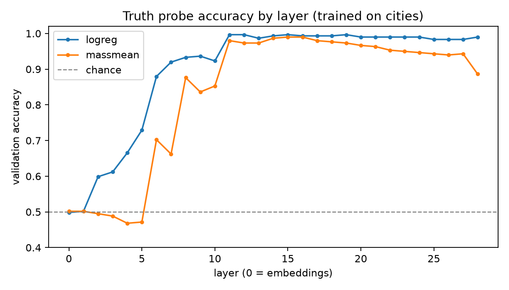
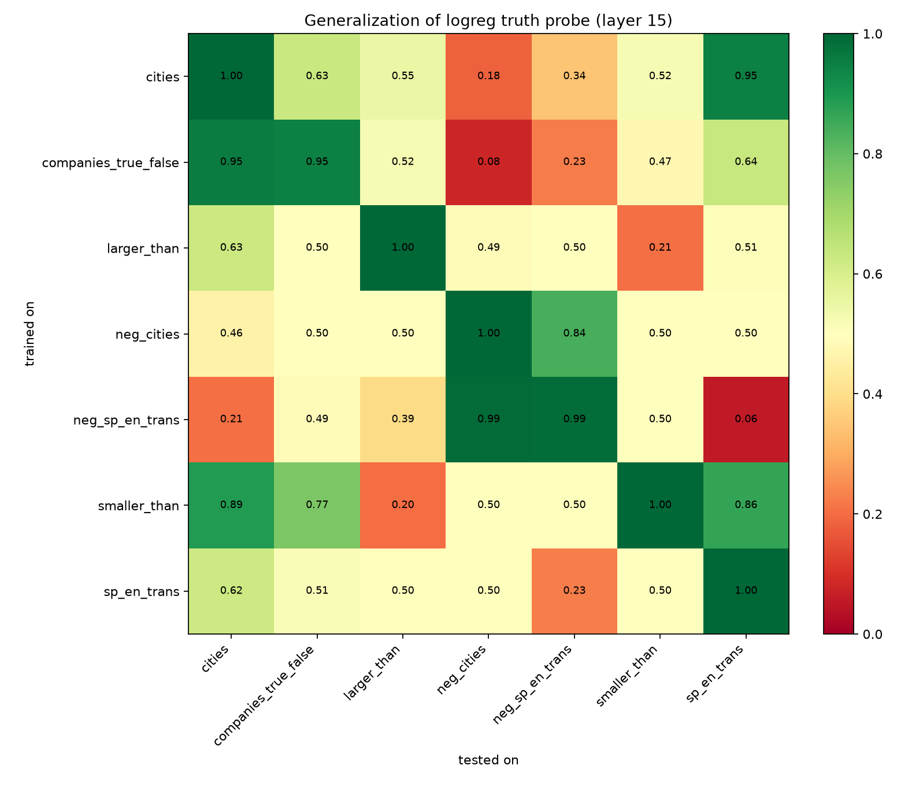
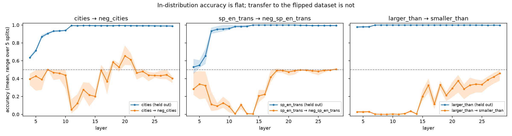

# Do linear truth probes generalize?

*Mouhammed Soumaille · October 2026*

**TL;DR.** I trained linear probes on the hidden states of Qwen2.5-0.5B and Qwen2.5-1.5B to read off whether a
statement is true. The probes are near-perfect on held-out data from the dataset they were trained on, and
partly transfer to other datasets. But a probe trained on affirmative statements is **reliably wrong on negated
ones** — it scores well *below* chance — at both model sizes. The inversion is weaker at 1.5B than at 0.5B but
does not go away. And at 1.5B, how badly the probe fails on negated statements depends strongly on which layer
it reads from, even across layers where in-distribution accuracy is flat at ~99% — and the layer you would
pick by in-distribution accuracy is the one where it fails worst.

This is a replication-and-extension of *The Geometry of Truth* (Marks & Tegmark, 2023), using their datasets.

## Question

Recent interpretability work trains simple linear "probes" on a language model's hidden states to tell whether
the model treats a statement as true or false. A probe that only works on the data it was trained on is not much
use as a safety tool. This project asks: **does a truth probe trained on one kind of statement still work on
other kinds of statements, and on negated statements?**

## Setup

- **Models:** Qwen2.5-0.5B-Instruct (24 layers + embeddings) and Qwen2.5-1.5B-Instruct (28 layers + embeddings).
- **Data:** true/false statement datasets from *The Geometry of Truth*: city locations (`cities`), negated city
  locations (`neg_cities`), Spanish–English translations (`sp_en_trans`), negated translations
  (`neg_sp_en_trans`), number comparisons (`larger_than`, `smaller_than`), and company facts
  (`companies_true_false`). Each dataset is balanced (50% true). The negated datasets reuse the same
  entity–attribute pairs as their affirmative counterparts, with "not" inserted and the label flipped.
- **Features:** the hidden state of the last token of each statement, at every layer.
- **Probes:** logistic regression on standardized features (C = 0.1), and a difference-of-means ("mass-mean")
  probe that needs no fitting beyond two averages.
- **Protocol:** 60/20/20 stratified train/validation/test split. The layer is chosen by validation accuracy on
  `cities`; in-distribution accuracy is reported on the held-out test split, and cross-dataset accuracy on the
  whole target dataset. Brackets are 95% bootstrap confidence intervals. Both models go through the same code
  with the same seed, so their splits are identical.

## Results

### 1. Truth is linearly readable from the middle of the network on

| | 0.5B | 1.5B |
|---|---|---|
| Layers near chance / weak | 0–6 (0.50–0.70) | 0–5 (0.50–0.73) |
| Sharp rise | layer 8 (0.93) | layer 6 (0.88) |
| Best layer (validation, `cities`) | 10 of 24 (0.963) | 11 of 28 (0.997) |
| Held-out test accuracy at that layer | 0.957 [0.933, 0.980] | 1.000 [1.000, 1.000] |
| After the peak | flat, 0.94–0.96 | flat, 0.98–1.00 |



The best layer sits at roughly 40% of the network's depth in both models, and accuracy stays high all the way
to the final layer.

### 2. Affirmative facts partly share a direction — but transfer is not uniformly better at scale

| Train → test (logistic regression) | 0.5B | 1.5B |
|---|---|---|
| `cities` → `sp_en_trans` | 0.675 [0.627, 0.720] | **0.946** [0.921, 0.969] |
| `companies` → `cities` | 0.808 [0.787, 0.828] | **0.955** [0.944, 0.965] |
| `sp_en_trans` → `cities` | **0.793** [0.772, 0.815] | 0.624 [0.599, 0.648] |
| `companies` → `sp_en_trans` | 0.520 [0.472, 0.571] | 0.636 [0.585, 0.684] |

Some transfers get much stronger at 1.5B and one gets weaker, so "bigger model, more general probe" is too
simple a summary. Each probe recovers its own dataset well (0.81–0.97 at 0.5B, 0.95–1.00 at 1.5B).



### 3. Negation inverts the probe

| Train → test (logistic regression) | 0.5B | 1.5B |
|---|---|---|
| `cities` → `neg_cities` | **0.044** [0.034, 0.054] | **0.182** [0.162, 0.201] |
| `sp_en_trans` → `neg_sp_en_trans` | **0.054** [0.031, 0.076] | **0.229** [0.186, 0.271] |
| `larger_than` → `smaller_than` | **0.055** [0.045, 0.065] | **0.207** [0.189, 0.225] |

On a balanced dataset, chance is 0.50. These probes are *confidently wrong*: they predict the opposite label most
of the time.

*Leading explanation.* The negated datasets reuse the same pairs ("Krasnodar / Russia") with "not" added and the
label flipped. A probe that reads "is this city–country pair correct?" and ignores the negation will predict the
pre-negation label, and so score near zero. The same mechanism explains `larger_than → smaller_than`: same
numbers, flipped relation. This replicates the negation failure reported by Marks & Tegmark.

*Scale.* The inversion is clearly weaker at 1.5B (the intervals don't overlap), so the larger model's probe is
partly sensitive to "not" — but it is still far below chance.

Probes trained on negated data transfer to *other* negated data, and more strongly at 1.5B:
`neg_sp_en_trans → neg_cities` goes from 0.731 [0.710, 0.753] to 0.989 [0.983, 0.994], and
`neg_cities → neg_sp_en_trans` from 0.788 [0.749, 0.833] to 0.836 [0.797, 0.873].

### 4. Which layer you read from matters for generalization



At 1.5B, in-distribution accuracy is essentially flat (≈0.98–1.00) from layer 11 onward — from layer 7 for
`larger_than` — so choosing a layer by in-distribution accuracy is close to arbitrary in that range. Transfer to
the flipped dataset is anything but flat:

- `sp_en_trans → neg_sp_en_trans` is almost perfectly inverted (≈0.00–0.10) at layers 8–14, then rises to
  chance (≈0.50) from layer 18 on.
- `cities → neg_cities` is most inverted at layer 11 (≈0.05), climbs to *above* chance around layers 18–21
  (≈0.65 at layer 20), and settles back to ≈0.40–0.45 in the last layers.
- `larger_than → smaller_than` is inverted (≈0.00–0.03) through layer 14, then climbs gradually but stays below
  chance (≈0.46 at layer 28).

Layer 11 — the layer chosen by validation accuracy on `cities` — is where the inversion is strongest for both
`cities` and `sp_en_trans`. The shaded band (5 random splits) is also wide in places, e.g. ≈0.55–0.77 for
`cities → neg_cities` at layer 20, so a single-split, single-layer transfer number (like the tables above) is
one point on a curve, not a property of "the" probe.

For a safety tool, this is the practical lesson: validating a probe on held-out data from the training
distribution says little about how it behaves under a simple distribution shift like negation.

### 5. Other differences between the two models

- **Number comparisons.** At 0.5B, `larger_than` and `smaller_than` transfer to nothing else (≈ 0.50, apart from
  the odd case below). At
  1.5B, `smaller_than` transfers broadly (→ `cities` 0.888 [0.872, 0.903], → `sp_en_trans` 0.86,
  → `companies` 0.77) while `larger_than` mostly does not (→ `cities` 0.628 [0.603, 0.652], other non-comparison
  datasets ≈ 0.50).
- **A likely spurious transfer goes away.** `larger_than → neg_cities` is 0.662 [0.639, 0.686] at 0.5B — odd for a
  probe that transfers nowhere else — and 0.491 [0.465, 0.519] at 1.5B.
- **Mass-mean vs. logistic regression.** The two-averages probe reproduces the same qualitative structure, which
  argues the patterns are not an artifact of fitting. At 0.5B it is clearly weaker in-distribution (`companies`
  0.62 vs 0.81, `larger_than` 0.76 vs 0.97). At 1.5B it is within about 0.1 of logistic regression in-distribution (furthest
  behind on `companies`, 0.80 vs 0.95) and generalizes better on some pairs (`neg_cities → neg_sp_en_trans` 0.99 vs 0.84,
  `companies → sp_en_trans` 0.97 vs 0.64).

## Limitations

- **Two small models from one family.** The scale comparison has two points; I can't say whether the inversion
  keeps shrinking at 7B and beyond.
- **Short, templated statements.** Surface features (shared vocabulary, sentence templates) may drive some
  transfers; the 0.5B `larger_than → neg_cities` result is a warning.
- **Single split in the main tables.** Section 4 shows split-to-split variation can be large for transfer numbers,
  so the exact values in the tables are less reliable than their direction.
- **No causal check.** Probes show what is linearly decodable, not what the model uses. Activation patching or
  steering along the probe direction would be needed to claim that.

## Next steps

- Train on affirmative **and** negated statements together (e.g. `cities` + `neg_cities`) and test on the
  translation datasets — a direct test of the pair-association explanation.
- Repeat the main tables over several splits and report means with intervals.
- Choose the layer by transfer on a held-out *dataset*, not just held-out *examples*.
- Run a 3B model to add a third point to the scale comparison.
- Steer along the probe direction and check whether the model's stated answer changes.

## Reproduce

```bash
git clone https://github.com/saprmarks/geometry-of-truth.git
pip install -r requirements.txt

python extract.py --model Qwen/Qwen2.5-0.5B-Instruct
python analyze.py --acts acts/Qwen__Qwen2.5-0.5B-Instruct --out results-0.5B

python extract.py --model Qwen/Qwen2.5-1.5B-Instruct
python analyze.py --acts acts/Qwen__Qwen2.5-1.5B-Instruct --out results
python layer_transfer.py --acts acts/Qwen__Qwen2.5-1.5B-Instruct --out results
```

0.5B figures are in `results-0.5B/`, 1.5B figures in `results/`.

## References

- S. Marks and M. Tegmark. *The Geometry of Truth: Emergent Linear Structure in Large Language Model
  Representations of True/False Datasets.* 2023.
